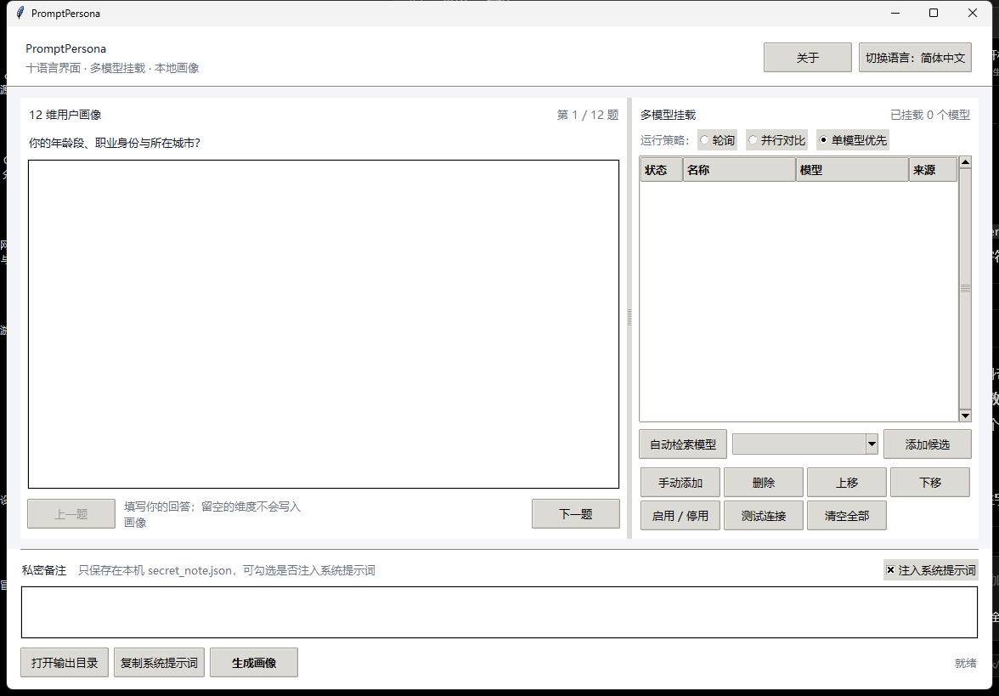
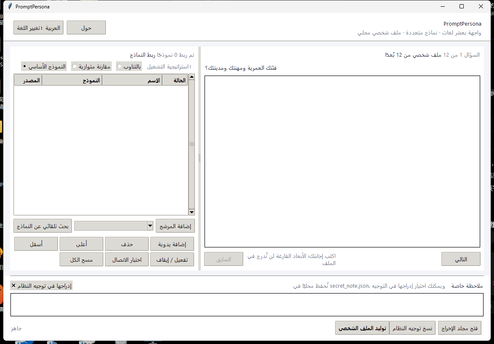

# PromptPersona — Local AI Persona & System-Prompt Builder

[](https://github.com/luoyuda123/PromptPersona/actions/workflows/ci.yml)
[](LICENSE)
[](https://www.python.org/)
[](#)

**Stop re-explaining yourself to every AI tool.** Answer 12 questions once, get a reusable persona file and a system prompt you can paste anywhere — in 10 languages, fully offline, with zero third-party dependencies.

> Pure Python standard library + Tkinter. No account, no cloud sync, no telemetry. Your answers and API keys never leave your machine.

## Why people use it

- **Write once, reuse everywhere** — questionnaire → `persona.json` (stable Chinese dimension keys) → `persona_system.txt` ready for any client that accepts a System Prompt
- **Ten UI languages** — Simplified/Traditional Chinese, English, Japanese, Korean, French, Russian, Spanish, German, and Arabic with a real RTL layout (mirrored panels, reversed table columns)
- **Bring your own models** — auto-discovery from a built-in OpenAI-compatible catalog, or add any endpoint manually; reorder, enable/disable, test the connection
- **Three execution strategies** — poll (round-robin with a persisted cursor), parallel comparison (up to 8 concurrent calls), or single-model primary
- **Private by design** — a separate `secret_note.json` for things you never want repeated, with an optional injection switch
- **Zero dependencies** — nothing to `pip install` to run it; the standard library `urllib` talks to the models

## Screenshots

Simplified Chinese — 12-dimension questionnaire on the left, model mounting on the right.



Arabic (RTL) — panels mirrored, alignment and table columns flipped.



## Quick start

1. Install **Python 3.9+** (on Windows, tick *Add python.exe to PATH*; Tkinter ships with the official installer).
2. Windows: double-click `启动.bat`. Or from a terminal:

   ```bash
   py main.py        # Windows launcher
   python3 main.py   # macOS / Linux
   ```

3. On first launch pick your interface language — it is saved to `config.json` and reused next time.
4. Fill in as many dimensions as you like (empty ones are dropped), mount a model on the right, then click **Generate persona**.
5. The result window has two tabs: the **system prompt** (one-click copy) and **model outputs** (how each model responds to that prompt).

Want a single-file exe? Double-click `打包exe.bat` → `dist\PromptPersona.exe`.

## Interface languages

| Code | Language | Notes |
| --- | --- | --- |
| `zh` | 简体中文 | default |
| `zh-tw` | 繁體中文 | |
| `en` | English | |
| `ja` | 日本語 | |
| `ko` | 한국어 | |
| `fr` | Français | |
| `ru` | Русский | |
| `es` | Español | |
| `de` | Deutsch | |
| `ar` | العربية | right-to-left, mirrored layout |

Every string and all 12 questions are translated by hand. A test enforces that **all ten locales share exactly the same key set and none is empty** — a missing translation fails CI.

## Connect a model

Both paths speak the OpenAI-compatible protocol (`POST {base_url}/chat/completions`):

- **Auto-discovery** — an 8-entry built-in catalog (GPT-4o, DeepSeek, Qwen, Kimi, Gemini, OpenRouter, Groq, local Ollama), filtered by the current UI language
- **Manual entry** — name / base URL / API key / model ID / local path; the base URL must start with `http(s)://`

Local model example:

```
Base URL : http://127.0.0.1:11434/v1
Model ID : qwen2.5:7b
API key  : leave empty
```

## Execution strategies

| Strategy | Behaviour | Good for |
| --- | --- | --- |
| Poll | Ask the next enabled model each run; the cursor is saved | Spreading quota / cost |
| Parallel | Ask all enabled models at once (max 8 workers), compare side by side | Picking a model, comparing style |
| Primary | Only the first enabled model | You already picked a favourite |

All requests run on background threads — the UI never freezes, and failures surface as text instead of tracebacks.

## Generated files

| File | Contents | Commit to git? |
| --- | --- | --- |
| `config.json` | language, strategy, models (including API keys), answers | **No** — already in `.gitignore` |
| `persona.json` | the persona with Chinese dimension keys | No — personal data |
| `secret_note.json` | private note + whether to inject it | No |
| `persona_system.txt` | the final system prompt | No |

When run from source these live in the project root; in a packaged exe they sit next to the executable (`storage.app_dir()` handles the difference). JSON is written atomically (temp file + `os.replace`), so a crash mid-write cannot corrupt your config.

## Project layout

```
.
├── main.py                  # entry point: DPI awareness, crash log fallback
├── app/
│   ├── ui.py                # Tkinter UI, result window, RTL handling
│   ├── i18n.py              # 10 locales, 12 questions, fixed Chinese labels
│   ├── models.py            # catalog, validation, dedupe, ordering
│   ├── persona.py           # persona + system-prompt builder
│   ├── providers.py         # OpenAI-compatible calls, 3 strategies
│   └── storage.py           # atomic JSON/TXT storage with defaults
├── tests/test_core.py       # 30 unit tests, incl. a local stub server
├── 启动.bat / 运行测试.bat / 打包exe.bat
├── 项目方案.txt / 第一代.txt  # original design notes (Chinese)
└── .github/workflows/       # CI + tag-triggered exe build
```

## Development & tests

```bash
py -m compileall -q app main.py tests
py -m unittest discover -s tests -v
```

Windows users can double-click `运行测试.bat`. The suite needs no display and covers:

- locale key parity, placeholder rendering, RTL detection
- persona keeps only non-empty dimensions, uses Chinese labels, honours the note toggle
- catalog filtering, field validation, duplicate detection, reordering
- config default merging, corrupted-JSON fallback, atomic writes
- a local HTTP stub emulating OpenAI responses: success, HTTP error, non-JSON body
- poll cursor advance, parallel result merging, primary-only selection

### Add a locale

1. Add an entry to `LANGS` in `app/i18n.py` (`code` / `label` / `rtl`);
2. Fill every key in `STRINGS` (including `q1..q12`);
3. Run the tests — key parity is enforced.

### Add a built-in model

Append one entry to `CATALOG` in `app/models.py`: `name` / `base_url` / `model` / `langs` (use the real locale codes).

## Build a Windows exe

```bash
py -m pip install pyinstaller
py -m PyInstaller --noconfirm --clean --onefile --windowed --name PromptPersona main.py
```

Or just double-click `打包exe.bat` (it installs PyInstaller if missing).
`--onefile` extracts on first start, so the first launch takes a second or two. If your antivirus complains, switch to `--onedir`.

Pushing a `v*` tag makes `.github/workflows/build-exe.yml` build the exe on a Windows runner and upload it as an artifact.

## Privacy & security

- Answers, notes and API keys are stored **only** in local files; the code contains no reporting logic
- Network calls happen only when you click *test connection* or *generate*, and only to the base URL you entered
- `config.json`, `persona*.json` and `secret_note.json` are git-ignored by default — double-check before sharing a fork

## FAQ

**Nothing happens when I double-click.** Check `startup-error.log` next to the app for the full traceback.

**"py" is not recognized.** Install Python and reopen the terminal, or edit `启动.bat` to call `python` instead.

**Connection test fails.** Make sure the base URL ends with `/v1` (e.g. `https://api.deepseek.com/v1`) and that the key has quota; for local models start Ollama first.

**The UI did not change language.** Switching rebuilds the window and keeps your answers; if it misbehaves, delete `config.json` and relaunch.

## Roadmap

- Model benchmark score (latency / cost / style) recorded per run
- Optional cloud catalog sync and import/export of persona packs
- More granular prompt templates (task-specific add-ons)

## License

[MIT](LICENSE)

---

### 中文简介

PromptPersona 是一个完全本地的用户画像生成器：填 12 道题，得到稳定中文标签的 `persona.json` 与可直接粘贴的系统提示词。
十种界面语言（含阿拉伯语 RTL）、OpenAI 兼容模型挂载、轮询/并行/单模型优先三种策略，纯标准库 + Tkinter，双击 `启动.bat` 即可运行。
